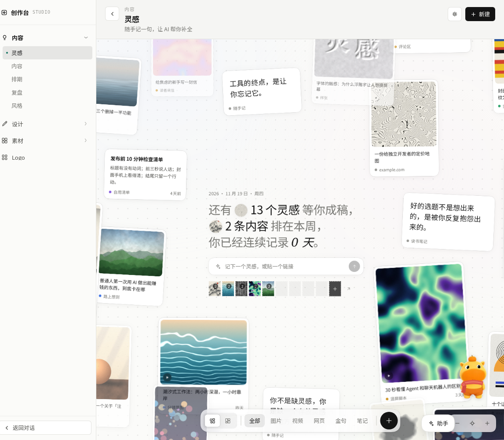

# dsh-creative-studio

Creative Studio (创作台) is a DSH plugin that puts four content tools behind one sidebar row: a writing workbench, a design workbench, a component gallery, and a logo editor.

**English** · [简体中文](README.zh-CN.md)

[](package.json)
[](LICENSE)



## The problem

Ideas, drafts, decks, cards, assets and a logo normally live in four different tools. Every switch costs context, and a finished design rarely finds its way back into the draft it was made for.

This plugin folds those four tools into one shell: one sidebar entry, one light theme, four workbenches that keep their state while you move between them, and a hand-off from a design work to a content draft.

## Quick example

After the plugin is enabled, the sidebar gains exactly one row:

```
DSH sidebar
└─ ✦ 创作台
   ├─ 内容   inspiration · posts · schedule · review · style
   ├─ 设计   overview · works · workflows · voice · examples
   ├─ 素材   103 components, filterable and searchable
   └─ Logo   pixel / vector editor, autosaved on this machine
```

Each pane mounts the first time you open it and is only hidden afterwards, so a draft you switched away from is still there when you come back.

## Install

The short path is the plugin page: **Add plugin** → paste this repo's absolute path → **Install** → turn on the `dsh-creative-studio` switch → reload the page.

The equivalent manual install, inside the DSH web profile:

```bash
cd /root/.dsh/profiles/web
pnpm add "dsh-creative-studio@link:/root/workspace/plugins/dsh-creative-studio"
```

Then add `"dsh-creative-studio"` to `dsh.profile.bundles` in that profile's `package.json` and restart the host:

```bash
pnpm install && systemctl restart deepseek-harness
```

A package that is installed but missing from `dsh.profile.bundles` is the usual failure: the install succeeds, the sidebar stays empty. The plugin's own `node_modules` (playwright, puppeteer-core, subset-font) only serve the bundled export scripts; install them in this directory with `PLAYWRIGHT_SKIP_BROWSER_DOWNLOAD=1 pnpm install` if you need PDF or long-image export.

## Usage

Open **创作台**, pick a workbench in the left column, and work in the content area. The title area carries the current page's actions, and the **新建** menu offers: record an idea, write a post, make a web PPT, open the logo editor, browse the asset library.

- `⌘[` / `Ctrl+[` returns to the chat; `↑` / `↓` move through the navigation.
- On a design work, **用于内容** posts its title into the content workbench, which then shows an "imported from Design" bar and can hand the piece to the assistant's composer.
- The assistant starts collapsed, and its open/closed state survives a reload.

## Configuration

No API keys and no external services: everything runs inside the DSH host process. Data lives in three directories under `$DSH_HOME` (default `~/.dsh`), and that variable is the only knob:

| Directory | Default | What it holds |
| --- | --- | --- |
| Content data | `$DSH_HOME/media-desk` | ideas, posts, schedule, style settings |
| Design library and voice profile | `$DSH_HOME/creative-studio` | registered works, per-work metadata, voice profile |
| Logo projects | `$DSH_HOME/pixel-logo-lab` | current project plus version snapshots, seeded from the bundled example on first run |

## What it doesn't do

- It doesn't publish. Drafts and designs stay on this machine; posting to a platform, scheduling on it, and pulling analytics back are all manual.
- The asset gallery is a pre-built copy of the threeui library (103 components). You browse and copy from it; you don't edit components in the panel.
- The logo editor writes only to `$DSH_HOME/pixel-logo-lab`. There is no cloud sync, no share link, no collaboration.
- Content and design run vendored copies of two upstream plugins (`media-desk` 2.7.1, `guizang-design` 0.1.4). Upgrading them means re-vendoring and rebuilding `client.js`, not bumping a dependency.
- A design work and a content draft are separate records. The hand-off passes the title across; it does not keep the two in sync afterwards.
- It has no accounts or permissions of its own — one DSH user, behind the normal login.

## Docs

Full design notes are in the Chinese README ([README.zh-CN.md](README.zh-CN.md)): how the vendored plugins are mounted and how `client.js` is generated, the interaction details, the shared light-theme token list, the brand normalization pass, the uninstall path back to the two separate plugins, and the acceptance checklist.

Upstream attribution and the list of modifications are in [NOTICE.md](NOTICE.md).

## Contributing

Patches are welcome. Run `npm run check` before sending one, and `node verification/verify-ui.mjs` for anything that touches the UI — it reads the login token from the host journal, and `TOKEN=…` overrides it. Don't hand-edit `client.js`: change `src/client.js` or a vendored pane and run `npm run build:client`.

## License

AGPL-3.0-only — see [LICENSE](LICENSE). The plugin embeds AGPL-3.0 code from `dsh-guizang-design`, which is why it carries that license; attribution and the modification list are in [NOTICE.md](NOTICE.md).
