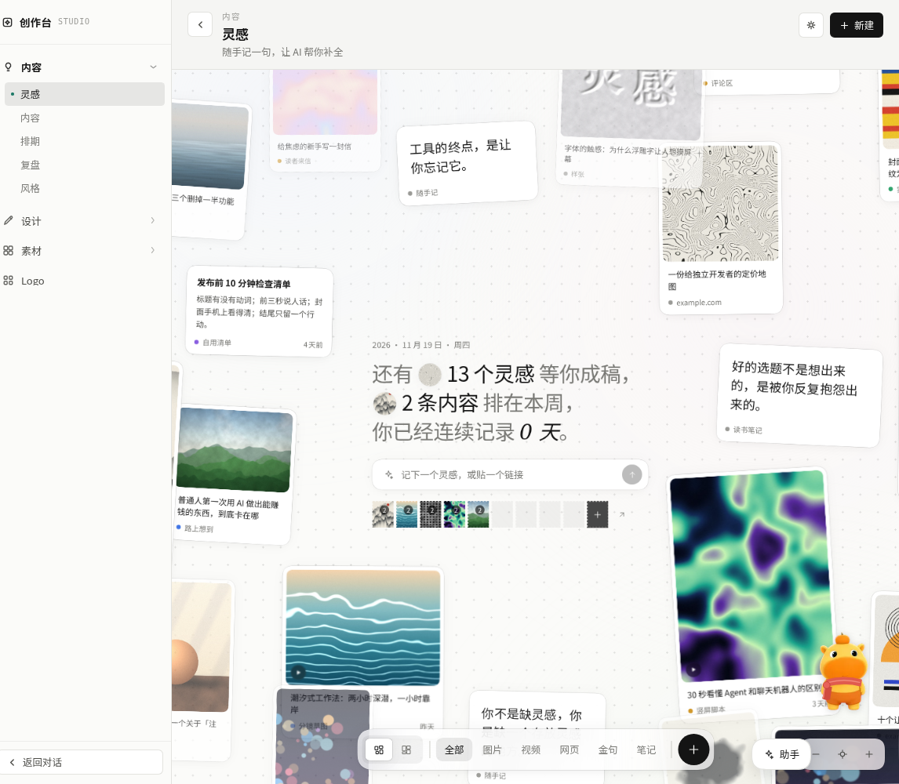

<div align="center">

# dsh-creative-studio 「创作台」

**DSH 里的内容创作工作台：写内容、做设计、找素材、改 Logo 都在一个面板里。**

A content studio for DSH: ideas, drafts, decks, cards and logos in one panel.

[](package.json)
[](LICENSE)
[](https://github.com/frankfurtlin/dsh-pocket)

[English](README.md) · **简体中文**

</div>



## 这是什么

创作台把原来分散在四个地方的创作工具收进一个 DSH 插件：`dsh-media-desk` 的自媒体工作流（灵感、内容、排期、复盘、风格）、`dsh-guizang-design` 的设计技能（网页 PPT、图文卡片、网页排版、去 AI 味）、threeui 的 103 个设计组件，以及像素 / 矢量 Logo 编辑器。侧栏只多一行入口，四个工作台共用一套浅色设计系统和统一标题区，写内容、做设计、找素材、改 Logo 都在同一个面板里切换。

它解决的问题是创作流程本身要跨好几套工具：灵感和成稿在一处，卡片和 PPT 在另一处，素材和 Logo 又在别的站点，来回切换容易丢上下文。现在这些都归到「创作台」下，设计作品可以直接带进内容草稿。

## 功能

- **内容**：灵感、内容、排期、复盘、风格五个子视图，从一句话灵感写到成稿，并按月排期。
- **设计**：网页 PPT、图文卡片、网页排版三个出图技能，加作品库与个人语气档案；「用于内容」可把作品带进内容工作台。
- **素材**：threeui 组件库 103 个组件，卡片显示中文名 + 英文 API 名，中英文搜索、一键复制。
- **Logo**：像素 / 矢量编辑器，三份母版、图层、版本快照与导出，工程数据存在本机。
- **统一外壳**：左栏手风琴导航、统一标题区、全局「＋新建」菜单；助手默认收起，状态记在浏览器里。
- **保活与懒加载**：四个 pane 首次访问才挂载、切走只隐藏，状态不丢；vendor 代码外置成单独文件，进创作台时才拉取。
- **可验收**：`verification/verify-ui.mjs` 用 headless chromium 跑 68 项真实浏览器断言。

## 安装

```bash
# 推荐路径：插件 → 添加插件 → 填本仓库绝对路径 → 安装 → 打开开关 → 刷新页面
# 等价的手工方式：
cd /root/.dsh/profiles/web
pnpm add "dsh-creative-studio@link:/root/workspace/plugins/dsh-creative-studio"
# 再把 "dsh-creative-studio" 加进 profile package.json 的 dsh.profile.bundles
pnpm install && systemctl restart deepseek-harness
```

侧栏只留一条 **创作台**，面板顶部四个 tab：**内容创作**、**设计**、**设计元素**、**Logo**。

- **内容创作**：从灵感走到成稿 —— 灵感、内容、排期、复盘、风格。
- **设计**：做内容的设计系统与 skill —— 网页 PPT、图文卡片、网页排版、去 AI 味。
- **设计元素**：threeui 组件库（103 个）—— 落地页、书本、场景、背景场、UI 控件，
  网格里并排、单组件模式里全屏看，组件自己的页面仍在 iframe 里跑。
- **Logo**：Web3 Odyssey 的像素 / 矢量 Logo 编辑器 —— 三份母版、图层、版本快照、导出。

内容创作与设计原本是两个独立插件（`dsh-media-desk` 与 `dsh-guizang-design`），v0.2.0 起
**源码级并入**本插件（`vendor/`），npm 上那两个包已从 profile 卸载；v0.2.1 起界面上的第三方
名称、logo、版本号全部换成「创作台」自己的品牌。Logo 编辑器原来是独立项目
`/root/workspace/pixel-logo-lab`（Python 小服务 + Caddy `/pixel` 部署），v0.3.0 起页面与
持久化 API 也并进本插件，成为第三个 tab。

```
侧栏                          创作台面板
┌──────────────┐   ┌─────────────────────────────────────────────┐
│ 插件          │   │ ✦ 创作台 │ 内容创作 │ 设计 │ 设计元素 │ Logo │  ‹ │
│ 创作台  ← 一条 │   ├─────────────────────────────────────────────┤
│ 自动化任务     │   │  三个 pane 各自保活，切走只是隐藏             │
│ 酒馆          │   │                                             │
│ …             │   └─────────────────────────────────────────────┘
```

## 架构：三个工作台的代码都在本插件里

本插件 **不依赖** 任何外部包或外部服务：`dsh-media-desk` / `dsh-guizang-design` 已从 profile
卸载，Logo 编辑器原来的 Python 服务也已删除（只保留插件这一份，见文末）。三份代码都在
`vendor/` 下，随本插件一起加载：

- **host 半片**：`lib/index.js` 分别 import `vendor/media-desk/src/host.js`、
  `vendor/guizang-design/lib/index.js`，把两者的 `apply(ctx)` 原样调用；Logo 编辑器的静态服务
  与 JSON 持久化 API 由 `lib/pixel-logo.js` 提供（`/pixel-logo/*`，语义对齐原 `server.py`）。
  于是 `/media-desk/*` 路由、`/guizang-design/*` 路由与展示库、5 个设计 skill、
  `guizang_library_add` / `guizang_voice` 两个工具、`/pixel-logo/*` 编辑器与 API、
  `/studio-elements/*` 组件库页面（`vendor/threeui` 的构建产物），全部由本插件提供。
- **client 半片**：`scripts/build-client.mjs` 在 Node 里用一个假的 `window.__ModuleLoader__`
  执行两份上游 client bundle，拿到它们的 `factory`，`toString()` 序列化后内联进
  `src/client.js` 的标记位，生成根目录的 `client.js`（一个合法的 DSH client 模块）。
  DSH 一个包只能声明一个 `exports["./client"]`，所以必须内联而不是并列引用。
- 运行两个 vendor client 的 `apply` 时套了一层受限 ctx（`createVendorCtx`）：它们的
  `sidebar.panellist` 注册被丢弃（侧栏只留「创作台」一行），`main` 槽注册、better-sidebar
  tab、theme/locale、`uiWorkspace` 等其它能力照常透传。之后本插件的 tab UI 通过
  `ctx.slots.entriesOfSlot('main')`（DSH 公开 API）按 key 取出两个面板组件来渲染。

```
dsh-creative-studio/
├── package.json            # 声明 dsh.bundle.patch / dsh.client / 依赖 / 构建脚本
├── cordis.patch.yml        # 把本包插进 web 组合
├── lib/index.js            # host：合并两个 vendor host 的 apply() + Logo 路由
├── lib/pixel-logo.js       # Logo 编辑器静态服务 + /pixel-logo/api/* 持久化
├── src/client.js           # client 源码：品牌位 + tab 条 + 内容/设计 pane + Logo iframe
├── client.js               # 生成物（勿手改）：src/client.js + 两份 vendor factory
├── scripts/build-client.mjs# 生成 client.js：内联 factory + 品牌字符串重写
├── vendor/media-desk/      # 上游 dsh-media-desk@2.7.1（MIT）拷贝 + 品牌文案改动
├── vendor/guizang-design/  # 上游 dsh-guizang-design@0.1.4（AGPL-3.0）拷贝 + 品牌改动
├── vendor/pixel-logo-lab/  # 原 /root/workspace/pixel-logo-lab 的页面、字体与三份母版
├── lib/elements.js        # 「设计元素」静态服务（/studio-elements）
├── vendor/threeui/        # 组件库构建产物（组件页面 + 落地页 + 书本 PNG）
├── threeui-src/           # 组件库源码（含 git 历史、报告生成脚本），构建产物从这儿出
├── verification/verify-ui.mjs  # Playwright 浏览器验收（63 项断言 + 截图）
├── verification/shots/     # 验收截图
└── NOTICE.md               # 上游项目、许可证归属与改动清单
```

### 交互细节

- 首次进入某个 tab 才挂载它的 pane，之后切走只是 `display:none`：内容创作里的草稿、
  当前页面不会因为切去「设计」再切回来而丢。
- 内容创作、设计两个 pane 各套一个 error boundary；某一侧挂了，只在它自己的 tab 里显示错误。
- Logo tab 是同源 iframe（`/pixel-logo/`），内部编辑器状态和自动保存由它自己的 API 负责；
  切走不卸载。
- 设计元素 tab 也是同源 iframe（`/studio-elements/`）：组件库页面、组件自己嵌的 iframe、
  落地页资产都走同一前缀，静态文件由 `lib/elements.js` 从 `vendor/threeui/` 读。
- 上次停留的 tab 记在 `localStorage`（`dsh-creative-studio:tab`）。
- 顶栏左端是自家品牌位（✦ 创作台），右侧显示当前 tab 的说明，`‹` 返回对话
  （`ctx.layout.selectPanel(null)`）。

## 视觉规范：三个 tab 一套浅色样式

三个工作台原本是三个独立产品（一个跟宿主题、一个瑞士风浅色、一个暗色编辑器），v0.4.0 起统一
到同一套浅色规范：**外壳、两个 iframe 页面都锁定浅色，不跟随 DSH 明暗主题**。

| 规范 | 值 |
| --- | --- |
| 底色 / 面板 / 卡片 | `#f5f5f3` / `#fbfbf9` / `#ffffff` |
| 描边（常规 / 弱 / 强） | `#e3e3df` / `#ededeb` / `#cdcdc7` |
| 文字（主 / 次 / 弱） | `#141414` / `#4d4d49` / `#787874` |
| 交互色 | `#1f7a68`（链接、选中、焦点框）；主按钮用墨黑 `#141414` + 象牙白文字 |
| 圆角 | 控件 8px、卡片 12px、面板 16px |
| 字体 | `Inter, "Noto Sans SC", …`；等宽标签 `JetBrains Mono` |
| 控件 | 按钮高 28–32px、1px 描边、8px 圆角、`outline: 2px` 焦点框 |
| 小标签 | 等宽 11px、`letter-spacing: .02–.06em`、二级灰 |

实现方式（不在三份 vendor CSS 里各改一遍，而是统一注入）：

- **外壳**：`src/client.js` 的 `STYLE_TEXT`，所有颜色/圆角/字体都是 `--cs-*` 变量；同时把
  media-desk 用到的 `--dsw-alias-*` / `--dsw-radius-*` / `--dsw-font-family` **钉死**在
  `.dsh-cs-root` 上（内容创作原本完全跟随宿主 token，这里锁成上面这套值，宿主切暗色它也不变）。
- **iframe 页面**：`attachStudioTheme()` 在同源 iframe 文档里注入 `<style id="dsh-cs-theme">`
  并给 `<html>` 打 `data-cs-studio` 标记。设计页的覆盖在 `DESIGN_THEME_CSS`（中立色、字体、
  卡片/按钮圆角），并让设计页始终停在 `data-scheme="light"`；Logo 页的浅色外壳在
  `LOGO_THEME_CSS`（顶栏/侧栏/工作区/按钮/输入/对话框/toast，控件圆角 8px）。
- **保留的内容色**：Logo 画布与预览 canvas 里的深底来自作品数据（`project.background`），
  设计页卡片上的瑞士风彩色是内容本身，二者都不属于「界面样式」，保持原样。
- 加新页面/新 tab 时：外壳用 `--cs-*` 变量；若是 iframe，在 `TabPane` 里保证它被
  `attachStudioTheme()` 找到（`kind:'iframe'` 或加进 `themed` 判断），再在对应的
  `*_THEME_CSS` 里补该页面的选择器。

### 对齐与中文化（2026-11-18）

- **内容创作右栏灵感卡**：上游是左对齐的表单式排版；这里用 `MEDIA_CARD_CSS`（`src/client.js`）
  只改对齐——标题/正文/提示居中、体裁与风格控件收成 168px 居中、按钮行居中，结构和交互不变。
- **Logo 页图层行**：`.layer-name` 改为 flex 居中（名称超长仍省略号），`开/锁` 与可见性按钮不变。
- **Logo 页文案中文化**：`vendor/pixel-logo-lab/index.html` 与 `app.js` 里对用户可见的英文
  （标题「像素 Logo 实验室」、工程信息「自定义 29 格符号网格 · 29×29 逻辑网格」、
  「O3 微型」「W3O 主题演讲映射」、图层默认名「未命名 / 图层 N」、错误与导入提示等）改成中文；
  只保留格式名（PNG/SVG/JSON）、品牌词（O3、W3O、Logo）和作品里的艺术字。
  新数据里的 `metadata.font`（如 `Custom 29-cell symbol grid`、`Logical cap height 18`）
  由 `fontLabel()` 映射成中文展示。

### 回归巡检：其他页面里同类的英文遗留（2026-11-18）

按「三个 tab 的其它视图/弹窗也扫一遍」的要求又修了三处，都是界面文案（数据、格式名、API 名、
品牌词不动）：

- **内容创作「排期」日历的月份**：上游月份数组 `["January", …]` 改成 `["1 月", …]`，月卡显示
  「2026 11 月」。改在 `scripts/build-client.mjs` 的 `BRAND_PATCHES['media-desk']` 里（vendor
  源码不动，上游升级后按 warn 提示补）。
- **风格页「导出为 Skill」/「已导出 Skill」** → 「导出为技能 / 已导出技能」；设置里的语言 chip
  `English` → `英文`。同样由 build 补丁完成。
- **设计页文案里的 skill**：`vendor/guizang-design/gallery/i18n.js` 的 zh 词条改成「技能」
  （「跨技能组合」「用上面任意一个技能做完一份」）。skill 的真实 id 仍是 `guizang-*`（与
  SKILL.md 绑定），只在内核与命令里出现，界面不展示。
- **有意保留的英文**：品牌与格式名（DeepSeek、OpenAI、xAI、PPT、CSV、PDF、PNG/SVG/JSON、
  WebGL、O3/W3O、Monid、平台名）、API 路径（`/images/generations`、`~/.dsh/...`）、作品哈希。

## 品牌归一：界面只体现「创作台」

| 位置 | 现在 |
| --- | --- |
| 侧栏条目 | 创作台（原有两条已不再注册） |
| 面板顶栏 | ✦ 创作台 + 内容创作 / 设计 / Logo |
| 设计页侧栏品牌 | 星标 logo + 创作台 · 内容 · 设计 |
| 设计页标题 / 页脚 | 创作台 · 设计 / 创作台（不显示上游版本号） |
| 设计页卡片 | 不显示 `/guizang-*` 命令行 |
| 模型提示词、风格文件头、错误提示 | 「创作台」 |
| 默认导出目录 | `~/Documents/创作台`（原先 `Documents/自媒体工作台`；旧文件不迁移） |

实现位置：

- `scripts/build-client.mjs` 的 `BRAND_PATCHES`：在序列化后的 factory 字符串上做替换
  （中文是 Unicode 转义形态，所以按 `\uXXXX` 匹配），把内联进来的面板 UI 里的
  「自媒体工作台 / Media Desk / 歸藏设计 / Guizang Design」换成创作台品牌。上游升级后若某条
  替换找不到目标会 `console.warn`，不会静默失败。
- `vendor/guizang-design/gallery/`：`brand.svg`（新 logo）、`index.html`、`i18n.js` 的中英品牌
  文案、`style.css` 隐藏卡片命令行。
- host 侧提示词与文案：`vendor/media-desk/src/{ai,en,export,learn,seed}.js`、
  `vendor/guizang-design/lib/{tools,skills,voice,library}.js`。
- 数据目录：设计侧作品库 / 语气档案改到 `$DSH_HOME/creative-studio`（改名时本机还没有旧数据，
  无迁移负担）；内容创作侧数据仍在 `$DSH_HOME/media-desk`，避免丢掉已有的灵感与内容；
  Logo 编辑器数据在 `$DSH_HOME/pixel-logo-lab`（见「原来的独立部署已删除」）。

**保留的第三方痕迹（有意为之）**：skill 的真实 id 仍是 `guizang-*`（与各 SKILL.md 的
frontmatter 绑定，改名会破坏 skill 调用），只在内核里出现，界面不展示；`guizang-design/examples/`
里的示例作品保留上游作者署名。

### 改了 vendor 代码怎么办

`vendor/` 是上游代码的拷贝（含上面的品牌改动）。升级上游时：把新版本的包内容覆盖进对应
`vendor/<name>/`，保留上游 `package.json`（host 从它读版本号给展示库），
然后 `npm run build:client` 重新生成 `client.js`，再跑验收。不要手改 `client.js`。

Logo 编辑器没有上游包：`vendor/pixel-logo-lab/` 现在就是唯一源码（原项目已归档，见下节）。
要改页面就改 vendor 里那几份文件；`lib/pixel-logo.js` 是原 `server.py` 的 JS 复刻，
接口变动时要同步改它。
品牌替换集中在 `scripts/build-client.mjs` 与 `vendor/*/gallery/`，升级后按 `npm run build:client`
的 warn 提示补齐即可。

## 原来的独立部署已删除

Logo 编辑器原来还有一份独立部署（`/root/workspace/pixel-logo-lab` 的 Python `server.py`、
systemd `pixel-logo-lab.service` → `127.0.0.1:4173`、Caddy `/pixel` 反代）。2026-11-18 起
这份部署已下线并删除：服务与开机自启、Caddy 的 `/pixel` 路由都已移除，**面板是唯一入口**
（走 DSH 登录态）。

- 编辑数据在 `$DSH_HOME/pixel-logo-lab/`（`current-project.json` + `history/`），首次运行时
  用打包的 `data/current-project.json` 做种子；
- 原项目（源码、造字脚本、`data/` 母版与旧自动保存快照）已打包归档到
  `/root/workspace/plugins/_backup/pixel-logo-lab-20261118.tgz`，工作目录
  `/root/workspace/pixel-logo-lab` 已删除；插件运行不依赖它。

## 依赖

`package.json` 的 `dependencies` 只服务 vendor 里的 skill 脚本与缩略图：

- `playwright`（设计页缩略图/卡片渲染；固定 `1.63.0`，与本机 `~/.cache/ms-playwright`
  里已有的 chromium-1243 对齐，避免下载浏览器）
- `puppeteer-core`（`guizang-page-skill` 的 PDF/长图导出，懒加载）
- `subset-font`（PPT/卡片脚本的字体子集化）

这些依赖装在插件自己的 `node_modules/` 里（profile 用 `link:` 引用本插件，pnpm 不会代装
被 link 包的依赖），需要时在本目录执行：

```bash
PLAYWRIGHT_SKIP_BROWSER_DOWNLOAD=1 pnpm install
```

## 安装

本机约定：插件源码在 `/root/workspace/plugins/dsh-creative-studio`，profile 以 `link:` 依赖引用。

推荐走 GUI：**插件 → 添加插件** → 填本目录的绝对路径 → 安装，然后在「已安装插件」列表里
把 `dsh-creative-studio` 的开关打开（安装只装依赖，开关才是挂载 bundle）。之后浏览器刷新即可。

手工方式（等价）：

```bash
cd /root/.dsh/profiles/web
# package.json: dependencies 加 "dsh-creative-studio": "link:/root/workspace/plugins/dsh-creative-studio"
#              dsh.profile.bundles 末尾加 "dsh-creative-studio"
pnpm install
systemctl restart deepseek-harness
```

> 安装进 profile 后要确认 `package.json` 的 `dsh.profile.bundles` 里出现
> `dsh-creative-studio`；只加依赖不加 bundle，刷新后不会出现「创作台」。

## 卸载 / 回退

v0.1.x 的老架构依赖并隐藏原插件；v0.2.x 已经把两个上游源码搬进 `vendor/`，原 npm 包已从
profile 删除。若要回退到「两个原插件分别安装」的状态：

1. 备份包在 `/root/workspace/plugins/_backup/`：
   `dsh-media-desk-2.7.1.tgz`、`dsh-guizang-design-0.1.4.tgz`；
2. 插件页关掉 `dsh-creative-studio`；
3. 在 profile 里 `pnpm add dsh-media-desk@2.7.1 dsh-guizang-design@0.1.4`（或指向解开的备份目录），
   再在插件页把这两个 bundle 打开。

## 验收

```bash
node verification/verify-ui.mjs          # 需要本机 DSH web 已运行；TOKEN=... 可覆盖登录 token
```

脚本用 headless chromium 打开真实 GUI，断言：

1. 侧栏只有「创作台」，没有「内容创作」「歸藏设计」这类重复入口；
2. 插件页已不再列出 `dsh-media-desk` / `dsh-guizang-design`，`dsh-creative-studio` 仍在；
3. 默认 tab 渲染出内容创作根节点 `.md-root`，且 `GET /media-desk/state`、
   `GET /media-desk/assets/aurora.jpg` 都正常；
4. 「设计」tab 的 `/guizang-design/` iframe 渲染出展示库正文，
   `/guizang-design/api/catalog` 版本号来自 vendor 的 `package.json`（0.1.4），
   `/guizang-design/examples/manifest.json` 与展示库页面外壳也正常；
5. 品牌归一：顶栏有「创作台」品牌位，设计页正文/标题/侧栏品牌都是创作台，不含第三方插件名、
   不显示上游版本号，也不露出 `guizang-*` skill id；
6. 「Logo」tab 的 `/pixel-logo/` iframe 加载出编辑器（标题、`#editorCanvas`），
   `GET /pixel-logo/api/project` 是 `schemaVersion:1`、母版与 `styles.css` 可取，
   `PUT /pixel-logo/api/project` 自动保存、版本快照 POST/GET/DELETE 往返都正常；
7. 统一浅色规范：外壳底色 `#f5f5f3`、顶栏 `#fbfbf9`、Inter 字体栈；设计 iframe 与 Logo iframe
   都注入了 `dsh-cs-theme` 且 `data-cs-studio=light`，设计页锁定浅色 scheme、卡片 12px / 按钮 8px
   圆角，Logo 顶栏浅色、按钮 8px 圆角；
8. 三个 pane 切走再切回都保活（内容创作、设计、Logo 之间互不重挂）；
9. 430px 窄屏下三个 tab 完整可见且可切换；刷新后记住上次 tab；
10. 灵感卡内容居中（卡片/标题/正文/按钮行的计算样式均为居中），Logo 图层名称居中，
    Logo 页标题与工程信息已中文化、可见文案不再有遗留英文（格式名/品牌名除外）；
11. 回归巡检：排期页月份已中文化（不再出现 `November`），风格页为「导出为技能」，
    设置里的语言选项是「英文」（不是 `English`），设计页五个视图点击后都有内容，
    可见文案不再出现 `skill`。

截图落在 `verification/shots/`（`03-*`/`03b-*`/`04-*`/`04b-*`/`04c-*` 为三个 tab 与灵感卡，
`07-theme-*`/`08-theme-*`/`09-theme-*` 为统一浅色后的整页效果，
`10-regression-schedule.png`/`10b-regression-design.png` 为回归巡检）。
最近一次结果：**63 passed, 0 failed**（2026-11-18，v0.4.2 回归巡检）。
